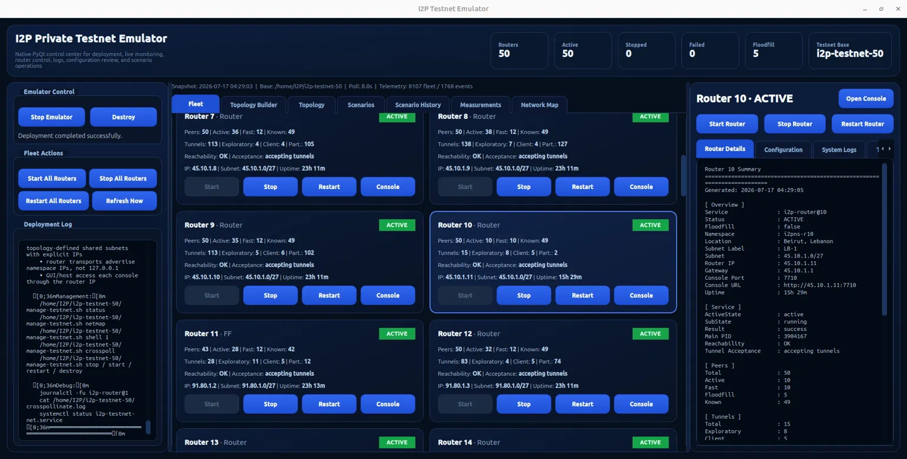

# Garlic-in-a-Box: I2P Network Emulator

A controlled, installable emulator that deploys a fully isolated network of
unmodified I2P Java routers, each in its own Linux network namespace, on a
single Ubuntu host. Built for reproducible I2P security research and hands-on
cyber-defence training.

[](LICENSE)
[]()
[]()



## What this is

Garlic-in-a-Box stands up dozens of real I2P routers, wires them into a
private overlay that mirrors the live network's structure, and gives the
operator full observational control over every router, tunnel, and peer. The
network is closed by construction: it can neither leak into the live I2P
network nor be perturbed by it, so experiments are safe, ethical, and
reproducible.

It accompanies the paper *Garlic in a Box: I2P Network Emulator* (CSET 2026).

## Key properties

- Runs the unmodified Java I2P reference implementation, not a model of it
- Each router isolated in its own Linux network namespace
- Filesystem bootstrap removes the dependency on signed reseed servers
- Synthetic geographic diversity activates I2P's location-aware peer selection
- A scenario engine for reputation injection, Sybil flooding, bandwidth
  inflation, and churn
- A profiles-as-measurement pipeline that reads on-disk peer state directly

## Install

Download the latest `.deb` from the
[Releases page](https://github.com/abksiddique/i2p-emulator/releases/latest),
then run:

```bash
sudo apt install ./i2p-emulator_1.0.0_all.deb
i2p-emulator
```

### From source

```bash
git clone https://github.com/abksiddique/i2p-emulator.git
cd i2p-emulator
sudo apt install python3 python3-pyqt5 openjdk-17-jre-headless iproute2 psmisc
pip3 install --break-system-packages pycountry countryinfo
python3 working-gui.py
```

## Requirements

- Ubuntu 22.04 LTS, 24.04 LTS, or 26.04
- Linux kernel with network namespace support (standard on all Ubuntu releases)
- Memory scales with router count (roughly 417 MB per router; a 50-router
  fleet settles near 21 GB)

## Reproducing the paper

The CSET 2026 study deploys 50 routers across five geographic locations
(France, Germany, Japan, Lebanon, United States) with five floodfills, then
runs a five-trial reputation attack.

1. Build the 50-router topology in the Topology Builder, or load the sample
   topology in `topologies/`
2. Deploy and wait about 25 minutes for full emergence, undisturbed
3. Run the reputation-injection scenario for five trials
4. Results are written to `AGGREGATE.json`

See [REPRODUCE.md](REPRODUCE.md) for the exact steps and expected figures.

## Results from the paper

| Metric | Result |
|--------|--------|
| Routers deployed | 50 across 5 locations |
| Emergence time | about 25 minutes |
| Memory footprint | about 21 GB (417 MB per router) |
| Selection-stage success | injection guarantees eligibility in all 5 trials |
| Tunnel selection ratio | attackers chosen 1.38x more than controls |

## Citation

If you use this software, please cite:

```bibtex
@inproceedings{muntaka2026garlic,
  author    = {Muntaka, Siddique Abubakr and Hussein, Faiza and
               Farah, Boutros and Kashi, Anthony and Bou Abdo, Jacques and
               Demerjian, Jacques},
  title     = {Garlic in a Box: {I2P} Network Emulator},
  booktitle = {Proc. Workshop on Cyber Security Experimentation and Test (CSET)},
  year      = {2026}
}
```

## Disclaimer

This platform runs in a completely isolated lab environment and does not
connect to or affect the live I2P network. It is intended for legitimate
security research, academic study, and training only. Users are responsible
for compliance with applicable laws and institutional policies.

## License

MIT, see [LICENSE](LICENSE).
